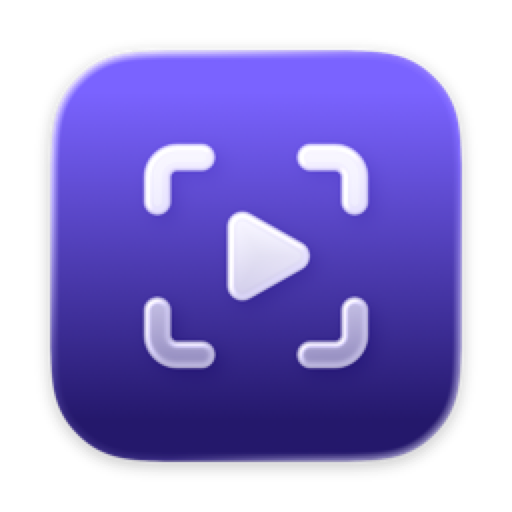
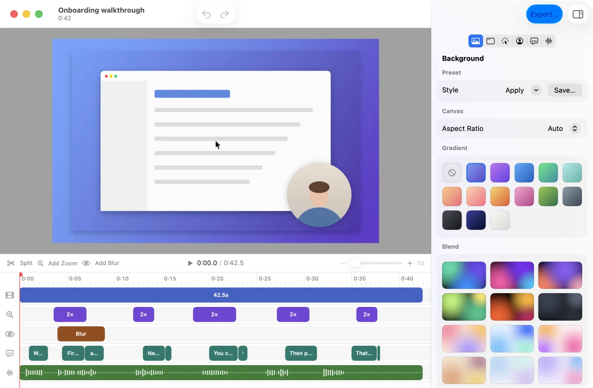
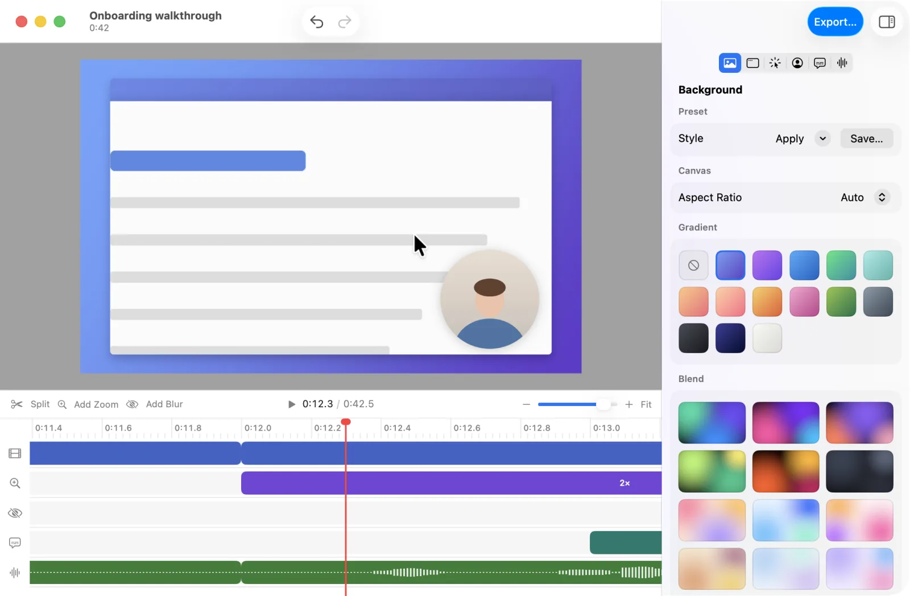
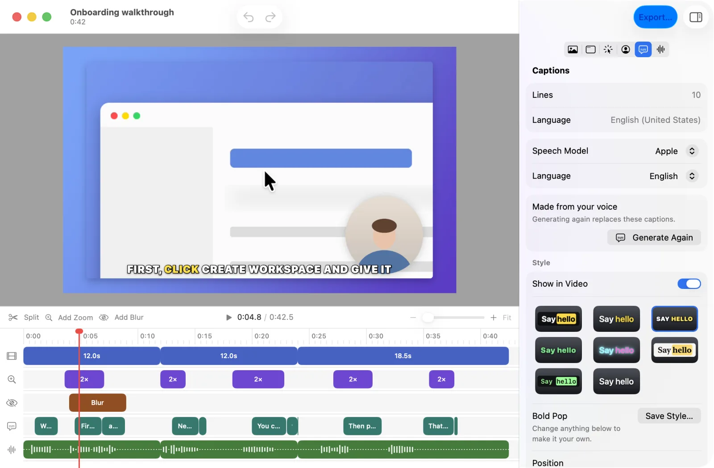
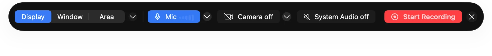
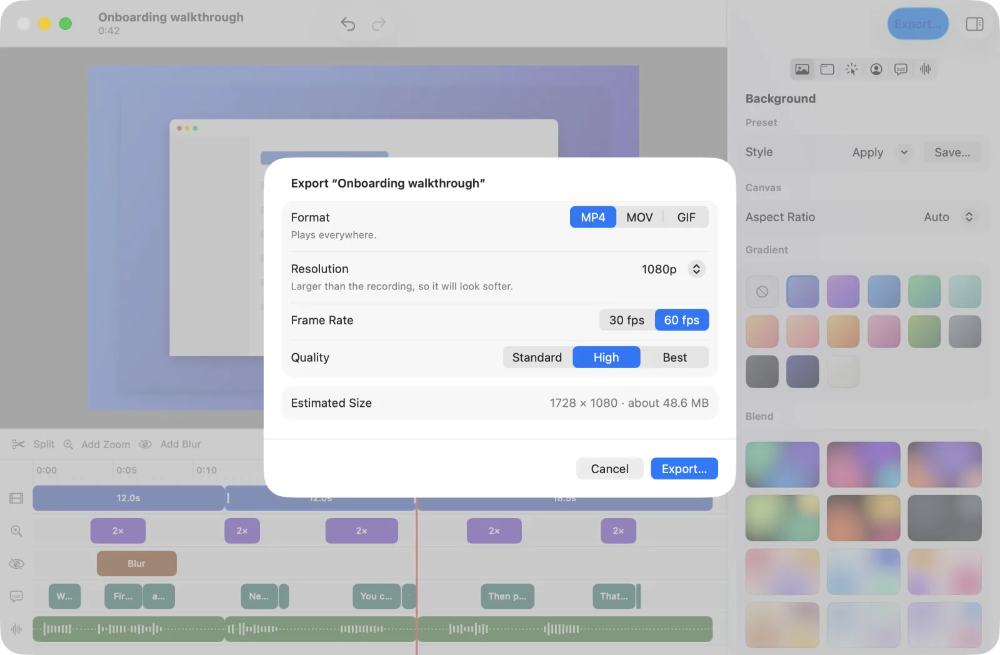

<p align="center">
  
</p>

<h1 align="center">Showreel</h1>

<p align="center">
  <strong>Record your Mac. Get a polished demo.</strong><br>
  A native macOS app that turns a screen recording into a finished product demo,<br>
  with auto-zoom, styled frames, a camera bubble, and captions. Free, offline, no account.
</p>

<p align="center">
  <a href="https://github.com/MomenSherif/Showreel/releases/latest/download/Showreel.dmg"><strong>Download for macOS 26</strong></a>
  &nbsp;·&nbsp;
  <a href="https://github.com/MomenSherif/Showreel/releases">All releases</a>
  &nbsp;·&nbsp;
  <a href="https://buymeacoffee.com/momensherif">Buy me a coffee</a>
</p>

<p align="center">
  <picture>
    <source media="(prefers-color-scheme: dark)" srcset="site/assets/shots/editor-dark.webp">
    
  </picture>
</p>

---

## Install

You need a Mac with **Apple silicon** (M1 or later) and **macOS 26 (Tahoe) or later**.

1. **Download** [Showreel.dmg](https://github.com/MomenSherif/Showreel/releases/latest/download/Showreel.dmg). It's always the newest build.
2. **Open** the DMG and **drag Showreel onto the Applications folder** next to it.
3. **Eject** the Showreel disk in Finder, then open Showreel from Applications or Spotlight.

### The first time you open it

Showreel isn't notarized by Apple yet, so the first time you open it macOS says *"Showreel" Not Opened*. Allow it once:

1. Click **Done** in that message. Don't click Move to Trash.
2. Open **System Settings → Privacy & Security** and scroll to the bottom.
3. Next to *"Showreel" was blocked to protect your Mac*, click **Open Anyway**, then enter your password.
4. Click **Open Anyway** again. From now on Showreel opens like any other app.

<details>
<summary>Prefer the Terminal?</summary>

This removes the downloaded-from-the-internet flag, which does the same thing as Open Anyway:

```sh
xattr -dr com.apple.quarantine /Applications/Showreel.app
```
</details>

### Permissions

Showreel asks for these the first time it needs them:

| Permission | Needed for | Required? |
| --- | --- | --- |
| **Screen Recording** | Recording your screen and system audio | Yes. Showreel reopens once you allow it. |
| **Microphone** | Recording your voice | Only if you turn the mic on |
| **Camera** | The camera bubble | Only if you turn the camera on |

You can change them any time in **System Settings → Privacy & Security**.

### Updating

Download the newest DMG and drag Showreel to Applications again, choosing **Replace**. Your projects and settings stay where they are.

After an update, macOS may ask for Screen Recording permission again. If recording shows a black screen, open **System Settings → Privacy & Security → Screen & System Audio Recording**, remove Showreel with **–**, and reopen Showreel to allow it again.

### Uninstalling

Drag **Showreel** from Applications to the Trash. To remove your projects, settings, and speech models too, also delete `~/Library/Application Support/Showreel`.

---

## What it does

**Record.** Pick a display, a window, or an area. Turn the mic, camera, and system audio on or off, then start from the menu bar or with **⌃⌥⌘R** from any app. Your face sits in a round bubble you can drag anywhere while you record.

**Auto-zoom.** Showreel zooms in where you click and eases back out, with no keyframes to set. Each zoom is a block on the timeline that you can move, resize, change, or delete.

**Style.** Choose a gradient, a soft blend, a wallpaper, or your own image. Set the padding, rounding, shadow or glow, crop, and aspect ratio. Add a Border, Browser, or MacBook frame in light or dark. Save the look as a preset for next time.

**Cursor.** The cursor is redrawn smooth and at any size. Keep the system arrow, hide it, pick a drawn style, or use your own picture. Clicks show a ripple or a ring.

**Captions.** Generate timed captions from your voice in one click, on your Mac. Use Apple's built-in speech model, or Whisper Small or Whisper Large v3 Turbo for more languages, including Arabic mixed with English. Edit the words and timing, and pick from eight looks or make your own.

**Blur.** Drag over an email address or an API key to blur or pixelate it. The blur stays on that spot of the screen when the video zooms or you crop it.

**Export.** Export MP4, MOV, or GIF at 720p, 1080p, or 4K, at 30 or 60 fps, with the file size shown before you start. Then share it with the Share sheet.

<table>
  <tr>
    <td width="50%">
      <picture>
        <source media="(prefers-color-scheme: dark)" srcset="site/assets/shots/editor-zoomed-dark.webp">
        
      </picture>
      <p align="center"><sub>Auto-zoom you can edit on the timeline</sub></p>
    </td>
    <td width="50%">
      <picture>
        <source media="(prefers-color-scheme: dark)" srcset="site/assets/shots/editor-caption-styles-dark.webp">
        
      </picture>
      <p align="center"><sub>Captions made on your Mac</sub></p>
    </td>
  </tr>
  <tr>
    <td width="50%">
      <picture>
        <source media="(prefers-color-scheme: dark)" srcset="site/assets/shots/record-panel-dark.webp">
        
      </picture>
      <p align="center"><sub>The record panel</sub></p>
    </td>
    <td width="50%">
      <picture>
        <source media="(prefers-color-scheme: dark)" srcset="site/assets/shots/export-sheet-dark.webp">
        
      </picture>
      <p align="center"><sub>Export with the size shown up front</sub></p>
    </td>
  </tr>
</table>

### Your recordings stay on your Mac

- **Local files.** Each project is a folder on your Mac, with the screen, camera, mic, and system audio kept as separate tracks.
- **On-device speech.** Captions are made on your Mac. Your voice is never uploaded.
- **Works offline.** The only download is a Whisper speech model, once, and only if you choose one in Settings → Captions.
- **No account.** No sign-up, no cloud upload, no share links. Share the file the way you already do.

### Handy shortcuts

| | |
| --- | --- |
| Start or stop recording, from any app | ⌃⌥⌘R (change it in Settings → Recording) |
| Pause or continue recording | ⌃⌥⌘P |
| Show or hide the camera | ⌃⌥⌘C |
| Play / pause in the editor | Space |
| Split at the playhead · Add zoom · Add blur | S · Z · B |
| Crop screen | ⌥⌘C |
| Generate captions | ⌥⌘G |

Every command is in the menu bar with its shortcut.

---

## Build from source

You need macOS 26 and **Xcode 26** (Swift 6.2 or later). There's no Xcode project: Showreel is a Swift package with a build script.

```sh
git clone https://github.com/MomenSherif/Showreel.git
cd Showreel
./build.sh --open
```

`build.sh` downloads whisper.cpp (checked by SHA-256), builds a release build, and installs it signed to `~/Applications/Showreel.app`. It signs with your Apple Development certificate if you have one, and ad-hoc otherwise. `--open` restarts the app with the new build.

| Command | What it does |
| --- | --- |
| `./build.sh --open` | Build, install, and relaunch |
| `swift test --scratch-path ~/Library/Developer/Showreel/test-build` | Unit tests and golden-frame renderer tests |
| `tools/selftest.sh` | Runs the app's real functions against a throwaway store in `/tmp` |
| `tools/snap.sh` | Light and dark snapshots of every page, in `/tmp/Showreel-shots` |
| `tools/make-dmg.sh` | Packs the installed app into `Showreel.dmg` |

### Project layout

```
Sources/Showreel/        the app: windows, editor, recording, settings (SwiftUI)
Sources/ShowreelKit/     rules and data logic, no UI
Sources/ShowreelEngine/  capture, writers, and the renderer (AVFoundation, Core Image)
Tests/                   unit tests and golden frames
Icon/AppIcon.icon        the Liquid Glass app icon (Icon Composer)
site/                    the landing page (static, deployed on Vercel)
docs/                    the brief, user stories, glossary, and design notes
```

See [ARCHITECTURE.md](ARCHITECTURE.md) for how the pieces fit together, and [docs/DESIGN.md](docs/DESIGN.md) for the design rules.

### Releases

Every push to `main` that changes the app builds a DMG on GitHub Actions and publishes it as a new release ([release.yml](.github/workflows/release.yml)). Pushes that only change the site, docs, or tests don't make a release. The landing page in `site/` deploys on Vercel only when something in `site/` changes.

---

## Support

Showreel is free. If it saves you time, you can [buy me a coffee](https://buymeacoffee.com/momensherif). For sponsorships, email momensherif.2019@gmail.com.

Found a bug or have an idea? [Open an issue](https://github.com/MomenSherif/Showreel/issues).
